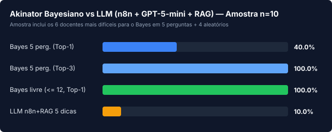

# Akinator Bayesiano vs. LLM — Docentes do DCOMP/UFS (SEMAC 2026)

Projeto desenvolvido para a **SEMAC 2026 (LADATA / UFS)** que compara duas abordagens distintas para resolver o clássico problema de adivinhação estilo *Akinator* aplicado aos **33 docentes do Departamento de Computação (DCOMP/UFS)**:

1. **Abordagem Clássica (Bayes + Índice de Gini):** motor probabilístico puramente matemático, determinístico, offline e interpretável, que escolhe as perguntas mais informativas dinamicamente.
2. **Abordagem Generativa (LLM + RAG no n8n):** agente conversacional baseado em `gpt-5-mini` com recuperação vetorial (`topK = 35`) sobre perfis textuais em Markdown, limitado a **5 dicas** fornecidas pelo jogador.

> **Jogar online:** funciona 100% estático em HTML/JS via **GitHub Pages** (para repositórios públicos) ou **Vercel** (gratuito inclusive para repositórios privados). O [`index.html`](index.html) na raiz redireciona automaticamente para [`web/index.html`](web/index.html).

---

## 1. Conceitos e Arquitetura

### 1.1. Akinator Bayesiano + Índice de Gini (`src/`, `scripts/`, `web/`)

Diferente de uma árvore de decisão rígida (onde um erro do jogador elimina o docente correto para sempre), o motor trabalha com **crenças probabilísticas suaves** sobre as 33 hipóteses $H_1, \dots, H_{33}$:

1. **Distribuição *a priori* uniforme:**
   $$P(H_i) = \frac{1}{33}, \quad \forall i \in \{1, \dots, 33\}$$

2. **Matriz de Verossimilhança suavizada $P(E \mid H)$ (`data/processed/perguntas_matriz.json`):**
   Construída por `scripts/build_likelihood_matrix.py` a partir das tabelas de docentes (`data/raw/docentes_dcomp_ufs.csv`) e vínculos docente–disciplina (`data/raw/disciplinas_dcomp_ufs.csv`, 1.545 registros). São **23 perguntas** divididas em 4 blocos:
   - `disciplinas` (12 perguntas): disciplinas de graduação frequentemente ministradas (POO, Programação Imperativa/A/B/C, ED/Grafos, Redes/SD, Arquitetura, Eng. Software, IA/ML, Imagens/CG, Compiladores/LFC, Banco de Dados, SO/Paralela, Ética e Sociedade).
   - `areas` (4 perguntas): Informática na Educação/IHC, Otimização/Algoritmos, Segurança/IoT/Nuvem, Saúde Digital/Bioinformática.
   - `pos_graduacao` (3 perguntas): atuação na pós-graduação, PROCC ou outros programas.
   - `formacao` (4 perguntas): graduação na UFS, formação no exterior, pós-doutorado e vínculo substituto.

   Cada par *(docente, pergunta)* é mapeado em uma distribuição suave para as respostas (`sim`, `nao`, `nao_sei`), evitando probabilidades `0.0` ou `1.0` e mantendo `P("nao_sei")` idêntico para positivos e negativos:
   | Estado semântico | `P(sim)` | `P(nao)` | `P(nao_sei)` | Uso |
   |---|---:|---:|---:|---|
   | `positivo` | 0,89 | 0,05 | 0,06 | Disciplina recente/recorrente ou atributo confirmado |
   | `negativo` | 0,05 | 0,89 | 0,06 | Ausência confirmada |
   | `parcial` | 0,62 | 0,24 | 0,14 | Oferta antiga/pontual ou menção indireta na descrição |
   | `desconhecido` | 0,34 | 0,33 | 0,33 | Campo não informado no SIGAA |

3. **Atualização pela Regra de Bayes:**
   A cada resposta observada $r \in \{\text{sim}, \text{nao}, \text{nao\_sei}\}$ para uma pergunta $q$:
   $$P_{\text{novo}}(H_i) = \frac{P(H_i) \cdot P(r \mid H_i, q)}{\sum_{j=1}^{33} P(H_j) \cdot P(r \mid H_j, q)}$$

4. **Seleção Dinâmica por Impureza de Gini:**
   A impureza de Gini mede o quão espalhada está a probabilidade atual ($0$ = certeza absoluta):
   $$\text{Gini}(p) = 1 - \sum_{i=1}^{33} p_i^2$$
   Antes de escolher a próxima pergunta não feita, o motor calcula o **Gini esperado** ponderado pela probabilidade marginal de cada resposta $P(r) = \sum_i P(H_i) P(r \mid H_i, q)$ e seleciona a pergunta que mais reduz a incerteza:
   $$\text{Gini}_{\text{esperado}}(q) = \sum_{r \in \{\text{sim}, \text{nao}, \text{nao\_sei}\}} P(r) \cdot \text{Gini}\big(P'(\cdot \mid r, q)\big)$$
   - **Modo benchmark (`top_k_aleatorio=1`):** 100% determinístico para reprodutibilidade.
   - **Modo interativo (`web/index.html` e `scripts/jogar_cli.py`):** sorteia entre as **Top-3 melhores perguntas de Gini** na 1ª rodada e entre perguntas praticamente empatadas (`margem_empate = 0,002`) nas seguintes, tornando as partidas variadas sem sacrificar a acurácia.

5. **Critério de Parada:**
   - **Modo 5 perguntas:** encerra após 5 perguntas (mesmo limite da abordagem LLM).
   - **Modo Livre:** encerra assim que o líder atinge **85% de confiança** (ou no máximo 12 perguntas).

---

### 1.2. Agente LLM + RAG (`llm/workflow.json`, `llm/base_de_conhecimento_rag_docentes_dcomp_ufs.md`)

A abordagem generativa implementa um fluxo no **n8n** composto por:
- **Indexação:** upload da base textual `llm/base_de_conhecimento_rag_docentes_dcomp_ufs.md` (perfis dos 33 docentes com sexo, categoria, sala, ramal, formação, áreas de interesse, atuação e Lattes) vetorizada com `embeddingsOpenAi` em um `vectorStoreInMemory`.
- **Agente Conversacional:** `gpt-5-mini` (`maxTokens = 3000`), memória de janela `memoryBufferWindow` (`contextWindowLength = 6`) e ferramenta de recuperação RAG configurada com `topK = 35`.
- **Dinâmica do Jogo:** o usuário envia dicas livres em linguagem natural; o agente controla o contador `[Dica 1/5]` até `[Dica 5/5]`, cruza os atributos recuperados e precisa cravar um palpite final até a 5ª dica.

---

## 2. Comparativos e Resultados Experimentais

### 2.1. Desempenho do Motor Bayesiano nos 33 docentes (`scripts/simular_benchmark.py`)

O limite inferior teórico da informação para distinguir 33 classes com perguntas binárias perfeitas é $\log_2(33) \approx 5{,}04$ bits ($\lceil \log_2 33 \rceil = 6$ perguntas).

| Estratégia do Motor Bayesiano | Modo 5 perguntas (Top-1 / Top-3) | Modo Livre ≤12, limiar 85% (Top-1 / Média perg.) |
|---|---:|---:|
| **Determinístico (Gini puro)** | 27/33 (**81,8%**) / 33/33 (**100,0%**) | 33/33 (**100,0%**) / **5,97 perg.** |
| **Dinâmico (Top-3 Gini na 1ª + margem 0,002)** *(20 rep.)* | **82,4%** / **99,7%** | **100,0%** / **6,07 perg.** |

No limite estrito de 5 perguntas (determinístico), os 6 docentes que não ficam em 1º lugar (todos presentes no **Top-3**) são: *Leonardo Nogueira Matos*, *Michel dos Santos Soares*, *Ricardo José Paiva de Britto Salgueiro*, *Rogério Patrício Chagas do Nascimento*, *Victor Flávio de Andrade Araújo* e *Giancarlo Lima Torres*. No modo livre, todos convergem para 100% em 6–8 perguntas.

---

### 2.2. Comparação Direta Bayes × LLM (`n = 10`, mesmo orçamento de 5 interações)

Para comparar ambos em condições controladas (`results/comparacao.csv` e `results/llm_resultados.json`), foram avaliados **10 docentes** em sessões independentes (abas limpas no chat público do n8n): os **6 docentes mais difíceis** para o Bayes em 5 perguntas + **4 aleatórios**, convertendo as 5 primeiras perguntas do Bayes em 5 dicas textuais equivalentes para o LLM.



| Método | Acertos Top-1 | % | Top-3 |
|---|---:|---:|---:|
| **Bayes (5 perguntas)** | 4/10 | 40,0% | **10/10 (100,0%)** |
| **Bayes (modo livre ≤12)** | **10/10** | **100,0%** | **10/10 (100,0%)** |
| **LLM (n8n + `gpt-5-mini` + RAG, 5 dicas)** | 1/10 | 10,0% | — |

#### Resultado docente a docente

| Docente | Bayes (5 perg.) | Bayes Livre (nº perg.) | LLM (5 dicas) | Palpite final do LLM |
|---|---:|---:|---:|---|
| LEONARDO NOGUEIRA MATOS | ❌ *(Top-3)* | ✅ (7) | ❌ (5 dicas) | Giovanny Fernando Lucero Palma |
| MICHEL DOS SANTOS SOARES | ❌ *(Top-3)* | ✅ (8) | ❌ (5 dicas) | Bruno Otavio Piedade Prado |
| RICARDO JOSE PAIVA DE BRITTO SALGUEIRO | ❌ *(Top-3)* | ✅ (7) | ❌ (5 dicas) | Admilson de Ribamar Lima Ribeiro |
| ROGERIO PATRICIO CHAGAS DO NASCIMENTO | ❌ *(Top-3)* | ✅ (7) | ❌ (5 dicas) | Hendrik Teixeira Macedo |
| VICTOR FLAVIO DE ANDRADE ARAUJO | ❌ *(Top-3)* | ✅ (6) | ❌ (5 dicas) | Carlos Alberto Estombelo Montesco |
| GIANCARLO LIMA TORRES | ❌ *(Top-3)* | ✅ (8) | ❌ (5 dicas) | *Sem resposta (`{"output": ""}`)* |
| CARLOS ALBERTO ESTOMBELO MONTESCO | ✅ | ✅ (5) | ❌ (4 dicas) | Glauco de Figueiredo Carneiro |
| BEATRIZ TRINCHAO ANDRADE DE CARVALHO | ✅ | ✅ (5) | ❌ (2 dicas) | Alberto Costa Neto |
| KENIA KODEL COX | ✅ | ✅ (7) | ✅ (3 dicas) | **Kenia Kodel Cox** |
| CALEBE MICAEL DE OLIVEIRA CONCEICAO | ✅ | ✅ (5) | ❌ (3 dicas) | Kenia Kodel Cox |

#### Principais achados qualitativos da comparação
1. **Assimetria da base de conhecimento (disciplinas do SIGAA):** a base `.md` do RAG contém formação e áreas de pesquisa, mas não lista disciplinas ministradas. Quando recebeu dicas sobre disciplinas (*ex.: Programação Imperativa, Banco de Dados, Compiladores*), o LLM aproximou por termos literais nas áreas de interesse e descartou o alvo correto (casos de Leonardo, Carlos Montesco, Beatriz e Calebe).
2. **Inversão lógica em dicas negadas/afirmadas:** na partida de *Michel dos Santos Soares*, a 5ª dica era afirmativa (*"O docente costuma ministrar Programação Imperativa..."*), mas o agente a interpretou como negativa (*"NÃO ministra Programação Imperativa"*) e eliminou o candidato correto.
3. **Parada prematura com excesso de confiança:** em Beatriz (2 dicas), Calebe (3 dicas) e Carlos Montesco (4 dicas), o LLM concluiu existir apenas um candidato compatível no RAG e cravou o palpite errado antes de usar todas as 5 dicas.
4. **Confiabilidade operacional:** na partida de *Giancarlo Lima Torres*, o webhook do n8n retornou saída vazia (`{ "output": "" }`) após a 5ª dica. O motor Bayesiano executa localmente em < 1 ms, com custo zero de API.

> **Ressalva metodológica:** as 5 dicas enviadas ao LLM foram derivadas das 5 primeiras perguntas selecionadas pelo próprio motor Bayesiano (que incluem disciplinas do SIGAA ausentes no RAG do colega), além de a amostra priorizar intencionalmente os 6 casos mais difíceis em 5 perguntas. Em um cenário restrito apenas a atributos presentes no `.md` (sexo, sala, instituição de doutorado, cargos), o RAG do LLM tende a ter desempenho bem superior.

---

### 2.3. Robustez do Akinator Bayesiano a Ruído (`results/robustez.csv`)

Simulação com `scripts/robustez.py` (30 repetições por docente = 990 partidas por cenário com ruído):

| Cenário de Ruído | Bayes 5 perg. (Top-1 / Top-3) | Bayes Livre ≤12 (Top-1 / Top-3 / Média perg.) |
|---|---:|---:|
| Sem ruído (0%) | 81,8% / 100,0% | 100,0% / 100,0% / 5,97 |
| 5% erro (`sim` ↔ `nao`) | 64,5% / 83,7% | 89,1% / 95,9% / 6,66 |
| 10% erro (`sim` ↔ `nao`) | 50,0% / 70,8% | 73,7% / 89,0% / 7,24 |
| 20% erro (`sim` ↔ `nao`) | 30,5% / 47,3% | 44,4% / 62,3% / 7,87 |
| 10% `"não sei"` | 65,5% / 95,3% | 99,7% / 100,0% / 6,85 |
| 20% `"não sei"` | 49,5% / 83,5% | 99,3% / 99,8% / 7,80 |
| 30% `"não sei"` | 36,6% / 71,8% | 96,0% / 99,6% / 8,92 |

Graças às probabilidades suavizadas e à neutralidade de `nao_sei`, mesmo quando o jogador responde *"Não sei"* em **30% das perguntas**, o modo livre ainda atinge **96,0% de acerto Top-1** (e 99,6% Top-3), apenas pedindo ~3 perguntas extras.

---

### 2.4. Resumo dos Trade-offs

| Critério | Akinator Bayesiano + Gini | Agente LLM + RAG (n8n) |
|---|---|---|
| **Acurácia com dados estruturados** | 81,8% (5 perg.) / 100% (livre) | Depende da cobertura textual do RAG (10% na amostra de disciplinas) |
| **Flexibilidade de entrada** | Fixa (`Sim`, `Não`, `Não sei`) sobre perguntas catalogadas | Alta (dicas livres em linguagem natural) |
| **Explicabilidade** | Total (posterior e queda de Gini auditáveis a cada passo) | Opaca (raciocínio verbal do LLM; sujeito a erros de filtro) |
| **Custo e Latência** | Zero, offline, < 1 ms (roda no navegador) | Chamadas de API/embeddings + latência de rede |
| **Determinismo** | Reproduzível (ou variação controlada por Top-3 Gini) | Estocástico e sensível à formulação da dica |

---

## 3. Como Executar

### 3.1. Interface Web (Local, GitHub Pages ou Vercel)
- **Localmente:** abra [`web/index.html`](web/index.html) diretamente no navegador (não precisa de servidor nem build).
- **GitHub Pages (repo público):** acesse **Settings → Pages → Source: Deploy from a branch → Branch: `main` / `/ (root)`**. O [`index.html`](index.html) redireciona para `web/`.
- **Vercel (repo privado ou público):** importe o repositório com **Framework Preset: Other** e **Root Directory: `./`** (ou `./web`).

### 3.2. CLI e Scripts Python
Requer apenas **Python 3.12+** (biblioteca padrão, sem dependências externas obrigatórias):

```bash
# Jogar no terminal (5 perguntas ou modo livre)
python3 scripts/jogar_cli.py --modo 5
python3 scripts/jogar_cli.py --modo livre
python3 scripts/jogar_cli.py --modo livre --deterministico

# Regerar a matriz de verossimilhança (data/processed/perguntas_matriz.json e web/matriz.js)
python3 scripts/build_likelihood_matrix.py

# Rodar benchmark completo nos 33 docentes
python3 scripts/simular_benchmark.py

# Avaliar robustez a ruído e "não sei" (atualiza results/robustez.csv)
python3 scripts/robustez.py

# Regerar tabela e gráfico comparativo Bayes × LLM (results/comparacao.csv e comparacao.svg)
python3 scripts/comparar.py
```

### 3.3. Abordagem LLM no n8n
1. Importe [`llm/workflow.json`](llm/workflow.json) na sua instância do n8n.
2. Configure suas credenciais da OpenAI nos nós de Chat e Embeddings.
3. Indexe [`llm/base_de_conhecimento_rag_docentes_dcomp_ufs.md`](llm/base_de_conhecimento_rag_docentes_dcomp_ufs.md) usando o formulário de carga do próprio workflow e abra o nó **Chat do Usuário**.

---

## 4. Estrutura do Repositório

```
├── index.html                                         # Redirecionamento para web/
├── README.md                                          # Documentação principal e comparativos
├── data/
│   ├── raw/
│   │   ├── docentes_dcomp_ufs.csv                     # Dados consolidados dos 33 docentes
│   │   └── disciplinas_dcomp_ufs.csv                  # 1.545 vínculos docente–disciplina (SIGAA)
│   └── processed/
│       └── perguntas_matriz.json                      # Matriz de verossimilhança P(E | H) (33 × 23)
├── src/
│   └── akinator_engine.py                             # Priors, Bayes, Gini, seleção e parada
├── scripts/
│   ├── build_likelihood_matrix.py                     # Gera perguntas_matriz.json e web/matriz.js
│   ├── jogar_cli.py                                   # Jogo interativo no terminal
│   ├── simular_benchmark.py                           # Benchmark nos 33 docentes
│   ├── robustez.py                                    # Simulação de ruído e "não sei"
│   └── comparar.py                                    # Consolida comparacao.csv e comparacao.svg
├── web/
│   ├── index.html                                     # Interface web estática do Akinator Bayesiano
│   └── matriz.js                                      # Matriz em JS gerada a partir do JSON
├── llm/
│   ├── workflow.json                                  # Fluxo n8n (gpt-5-mini + RAG + memória)
│   └── base_de_conhecimento_rag_docentes_dcomp_ufs.md # Base textual utilizada pelo agente RAG
└── results/
    ├── llm_resultados.json                            # Log das 10 partidas reais no chat LLM
    ├── comparacao.csv                                 # Resultados pareados Bayes × LLM
    ├── comparacao.svg                                 # Gráfico comparativo exibido neste README
    └── robustez.csv                                   # Tabela completa de robustez ao ruído
```
